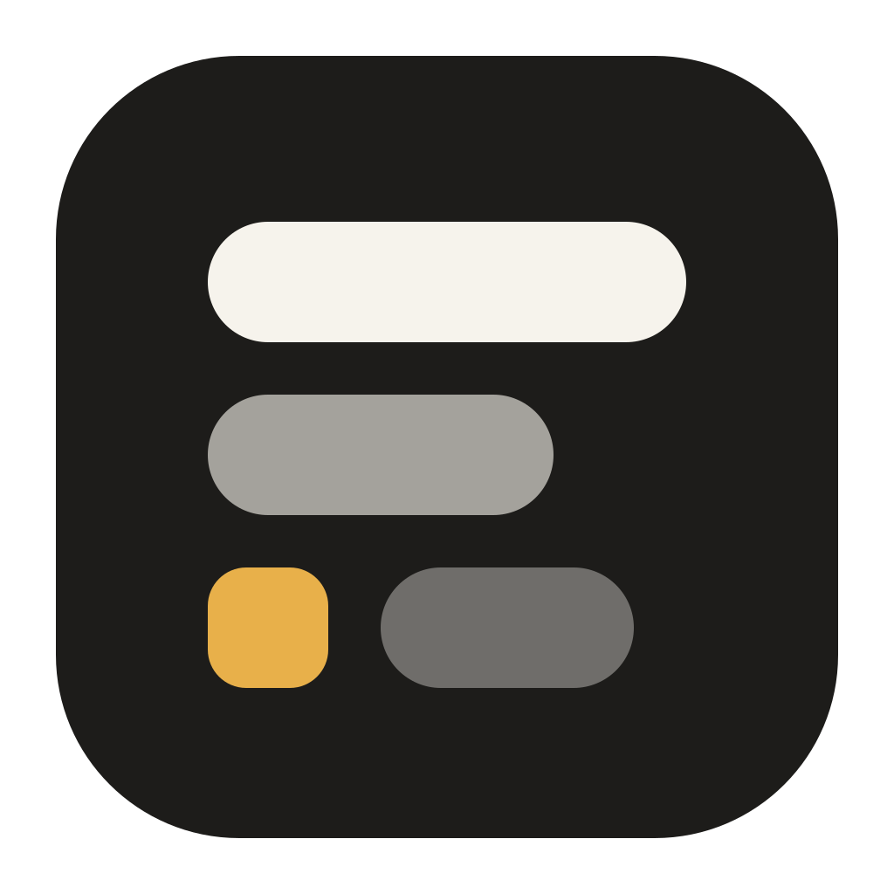
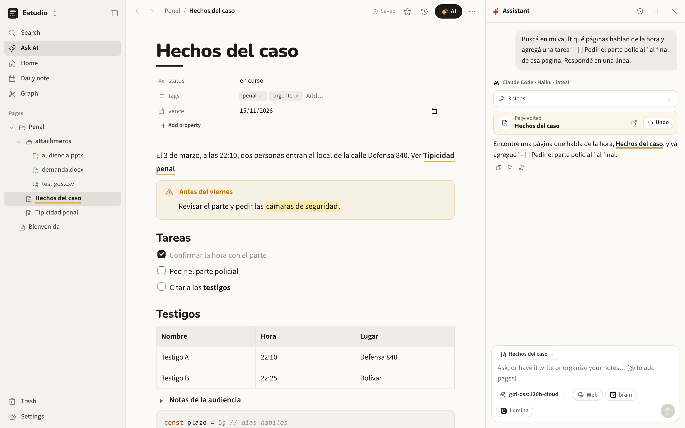

<p align="center"></p>

<h1 align="center">OpenBlocks</h1>

<p align="center"><b>Block notes, in your own folder.</b><br>
Writes like Notion, saves like Obsidian: a block editor on a folder of Markdown files you own,<br>
with databases, file previews, a graph, page history and AI agents that use your own models.<br>
macOS, Windows and Linux.</p>

<p align="center">
<a href="https://lautaro005.github.io/openblocks/">Website</a> ·
<a href="https://lautaro005.github.io/openblocks/docs.html">Docs</a> ·
<a href="https://github.com/Lautaro005/openblocks/releases">Releases</a> ·
<a href="CHANGELOG.md">Changelog</a> ·
<a href="https://lautaro005.github.io/openblocks/privacy.html">Privacy</a>
</p>

<p align="center">
<a href="https://github.com/Lautaro005/openblocks/releases/latest"></a>
<a href="https://github.com/Lautaro005/openblocks/actions/workflows/ci.yml"></a>

<a href="LICENSE"></a>
</p>

<picture>
  <source media="(prefers-color-scheme: dark)" srcset="assets/screenshot-dark.png">
  
</picture>

## Install

macOS / Linux:

```bash
curl -fsSL https://raw.githubusercontent.com/Lautaro005/openblocks/main/install.sh | sh
```

Windows (PowerShell):

```powershell
irm https://raw.githubusercontent.com/Lautaro005/openblocks/main/install.ps1 | iex
```

The app goes to `/Applications/OpenBlocks.app` on macOS (or `~/Applications` with `--user`), to
`~/.local/opt/openblocks` with a menu entry on Linux, and to your user's programs on Windows. You also get the
`openblocks` command: `openblocks` opens it, `openblocks update` updates it, `openblocks uninstall` removes it (your
vaults are never touched). No build for your platform yet? Add `-s -- --build` to compile from source (needs git,
Node and Rust).

The macOS app is signed with OpenBlocks' own certificate, so macOS remembers what you allow (like a vault on a USB
drive) across updates. It is not notarized by Apple: the install script clears the quarantine flag, and a `.dmg`
downloaded by hand opens with right-click → Open the first time. Windows SmartScreen may ask for "More info → Run
anyway".

## What it does

| | |
|---|---|
| **Your folder, your files** | A vault is any folder. Pages are `.md` files with Obsidian's syntax: `[[links]]`, `![[embeds]]`, `#tags`, YAML properties, `> [!note]` callouts. Open an existing Obsidian vault as is; edits from other apps show up at once. |
| **Block editor** | `/` menu, headings, tasks, tables, highlighted code, callouts, toggles, drag handles, Markdown shortcuts, paste Markdown as blocks, page properties, daily notes and templates. `/page` makes a linked subpage. Columns like Notion's (up to 4, drag a block beside another), toggle headings, `⌘F` find and replace (case, whole word, regex), and a desktop-style rectangle to select many blocks at once. No separate edit mode: the document is the view. |
| **HTML artifacts** | `.html` pages that run inside the app, like Claude's artifacts: a View/Code toggle, spreadsheets linked as live data (`openblocks.table()`), embedded in pages with `![[file.html]]`, and made by the AI on request. Sandboxed: no access to your vault or the network. |
| **Files** | Drop any file on a page. PDF, Word, Excel, CSV, PowerPoint, images, audio and video preview on the side (drag its edge to resize) or in a floating window — read locally, no internet. PDFs open in a built-in viewer with zoom and selectable text, and `.xlsx`/`.csv` in a spreadsheet editor with formulas. |
| **Import from Notion** | Settings → Import brings a whole Notion workspace — pages, subpages, databases with typed properties, images and files — with an integration token or Notion's own `.zip` export. Links become `[[wikilinks]]`. |
| **Sidebar and folders** | A resizable sidebar that floats over the page when hidden (mouse to the left edge). Folders open with a click on their name and list their contents sorted by name, date, type or by hand, as a list or a grid — or open on an HTML page of their own. |
| **Databases** | Any folder as a table or a board: pages are rows, properties are editable columns, stored in each page's frontmatter. |
| **Links and graph** | Backlinks, unlinked mentions, a force-directed graph, tag pages. Renaming or moving a page rewrites every link to it. |
| **History and trash** | A version every ten minutes of editing and before every AI change, restorable in a click. Deleted items go to a trash inside the vault. |
| **AI with agents** | A chat whose agents search, read, create, edit, move, rename and delete pages and folders — each change with an Undo card. Attach files (PDF, Word, Excel, images…). `⌘.` writes with AI on the current line. Context from the open page and `@` mentions; Web, brain and Lumina search. |
| **Your models** | Ollama and LM Studio (local), Claude Code and Codex (your login), Anthropic, OpenAI-compatible APIs and OpenRouter (your key), your OpenCue agents, and Gemma 4 running on your computer. No accounts, no servers of ours. |
| **Local vision** | Gemma 4 reads the text of images and scanned PDFs; EmbeddingGemma 2 finds images in the vault by what they show. Both run with llama.cpp — from Lumina when it is installed, so nothing is downloaded twice. |
| **MCP** | `openblocks mcp` gives Claude Code, Codex, Cursor and AI WorkStudio the same tools, for one vault or all of them — and, through a Cloudflare tunnel with a secret token, to agents in the cloud. |
| **Appearance** | Settings → Appearance: light or dark, four palettes (warm, neutral, sepia, high contrast), any accent color, fonts for text, headings and interface (or any font you have installed), text size, line spacing, page width and the size of the whole interface (`⌘+`/`⌘−`). |
| **Everything else** | Tabs (optional, Settings → General), `⌘K` search and commands, favorites, Spanish and English, print to PDF, export to Markdown/HTML. |

## The AI WorkStudio family

OpenBlocks is part of [AI WorkStudio](https://github.com/Lautaro005/workstudio) and talks to its siblings through their
local port, command and MCP server — never by copying their data:

- **[AI WorkStudio](https://github.com/Lautaro005/workstudio)** — Settings → Family → *Add to WorkStudio* registers
  OpenBlocks in `~/.workstudio/apps.json`: it appears on WorkStudio's home, opens inside it, and its tools join the
  single MCP server as `openblocks__*`.
- **[brain](https://github.com/Lautaro005/brain)** — the chat's *brain* pill searches your long-term memory; *Save to
  brain* writes a page into brain's vault with its own `write_file` tool.
- **[Lumina](https://github.com/Lautaro005/lumina)** — the *Lumina* pill searches your meetings, transcripts and notes,
  and OpenBlocks runs its local models with Lumina's llama.cpp and Gemma 4 instead of downloading them again.
- **[OpenCue](https://github.com/Lautaro005/opencue)** — your agents show up in the model picker and work inside
  OpenBlocks with their own model, instructions and memory, using the vault tools.

## Use it with your agents (MCP)

```bash
claude mcp add openblocks -- openblocks mcp
codex mcp add openblocks -- openblocks mcp
```

```json
{ "mcpServers": { "openblocks": { "command": "openblocks", "args": ["mcp"] } } }
```

Tools: `search_pages`, `read_page`, `list_pages`, `backlinks`, `find_images` (with EmbeddingGemma 2), `create_page`,
`edit_page`, `set_property`, `create_folder`, `move`, `delete`, and with `--with web,brain,lumina` also `web_search`,
`web_fetch`, `brain_search`, `lumina_search`.

Which vaults: with no option, what Settings → Family → MCP says (the open vault, or all of them); `--all` offers every
vault (tools take a `vault` argument and there is a `list_vaults` tool); `--vault <dir>` offers one. `--read-only`
removes the tools that change anything.

**Remote access.** Settings → Family → *Remote access by URL* publishes the same MCP server with a Cloudflare tunnel, for
agents that run in the cloud (Claude.ai, ChatGPT, Manus…) or on another computer. OpenBlocks serves MCP over HTTP on
`127.0.0.1:47890` and `cloudflared` publishes it: a quick tunnel (`*.trycloudflare.com`, no account) or your own
named tunnel and domain. The URL carries a secret token (`https://…/<token>/mcp`, or `Authorization: Bearer <token>`);
without it every request gets `404`. Regenerate the token to cut off a URL, and turn on read-only to keep remote
agents from changing anything. `cloudflared` is used from your PATH or downloaded from Cloudflare's release and checked
against the published SHA256.

## How it is built

```
crates/core/          Rust core: vault, index and search, Markdown/frontmatter, links, previews (docx, xlsx, pptx, csv),
                      history and trash, file watcher, AI providers and agent tools, MCP client and server, family
                      integrations, and the local HTTP server (axum) that serves the UI and the API
apps/desktop/         React + TipTap UI (src/) and the Tauri 2 shell (src-tauri/): the `openblocks` binary
site/                 website (GitHub Pages): landing, docs, privacy, changelog, llms.txt
install.sh            installer for macOS and Linux
install.ps1           installer for Windows
.github/workflows/    CI (fmt, clippy, tests, UI build on 3 systems), Release (tauri-action), Pages
```

The desktop window loads the UI from the core's own server on `127.0.0.1:47880`, so the same app works in a browser
(`openblocks serve`) and inside AI WorkStudio. Release builds use fat LTO, one codegen unit and stripped symbols.

### Develop

```bash
cd apps/desktop && npm install && npm run build   # build the UI once (it is embedded in the binary)
cargo run -p openblocks -- serve                  # server + UI at http://127.0.0.1:47880
npm run dev                                       # hot-reloading UI at http://localhost:1440 (proxies /api)
npx tauri dev                                     # the desktop app
cargo test -p openblocks-core                     # tests
```

`OPENBLOCKS_HOME` moves the settings folder (handy for testing without touching your real settings).

## Privacy

No accounts, no telemetry, no servers of its own. Your notes, history, trash and chats stay in your vault; settings and
API keys stay in `~/.openblocks/settings.json` (mode 600). The app goes online only for what you ask: a cloud AI model,
the Web pill, or the update check. Details in the [privacy policy](https://lautaro005.github.io/openblocks/privacy.html).

## Security

Please report vulnerabilities privately — see [SECURITY.md](SECURITY.md).

## License

[Apache License 2.0 with the Commons Clause](LICENSE): free to use, modify and share, but you may not sell OpenBlocks
or a product or service whose value comes substantially from it. © 2026 Lautaro Silva Sikora.
